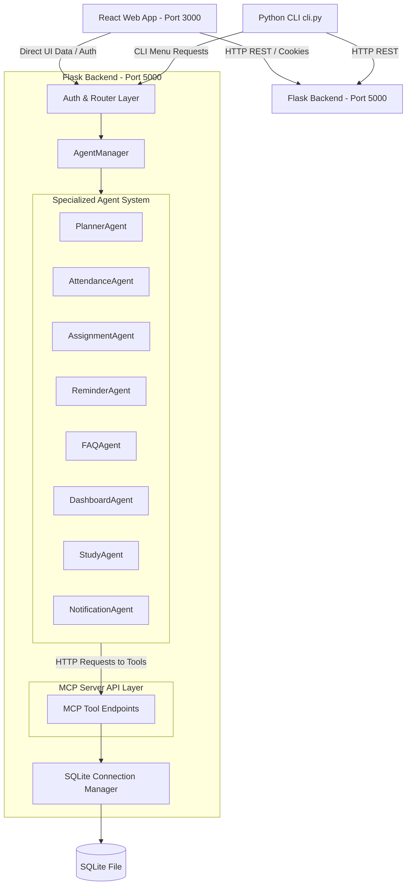

# CampusMate AI – Intelligent Student Concierge Agent

CampusMate AI is a production-ready, fully modular, secure, and offline **Intelligent Student Concierge Agent** built as a Google Capstone Project. It helps students organize their academic lives by coordinating a specialized **Multi-Agent System** that acts on data through a local **Model Context Protocol (MCP)** REST API Server.

This application is designed to run **100% offline** with **zero external API dependencies** (no OpenAI, Gemini, or Claude keys required). All intelligent planning, advisories, search patterns, and reminders are driven by offline rule-based heuristics, decision trees, and local text index engines.

---

## 🚀 Key Capstone Architecture Concepts

### 1. Multi-Agent System (Google ADK Style)
CampusMate AI coordinates eight specialized agents using a mediator/orchestrator pattern managed by the `AgentManager`.
* **Agent Isolation:** Agents never communicate directly; all inquiries and responses flow through the `AgentManager`.
* **Data Boundary Constraints:** Agents are strictly forbidden from accessing the database directly. They query and modify database states only by invoking REST tool endpoints on the local MCP server.
* **Specialized Agent Roles:**
  * **PlannerAgent:** Generates study schedule structures using subject credits, difficulties, and upcoming assignment deadlines.
  * **AttendanceAgent:** Computes attendance percentages and predicts consecutive classes needed or missable.
  * **AssignmentAgent:** Groups, prioritizes, and alerts students of overdue or urgent assignments.
  * **ReminderAgent:** Combines the active day's timetable classes, study plans, and deadline tasks.
  * **FAQAgent:** Queries local static files using keywords matching to resolve campus policy questions.
  * **DashboardAgent:** Formats aggregated metrics into visualization datasets for React charts.
  * **StudyAgent:** Recommends focus hours and Pomodoro techniques for rigorous or low-performing subjects.
  * **NotificationAgent:** Monitors thresholds and records database alert warnings for risk conditions.

### 2. MCP Server Architecture
A REST API server wraps a SQLite database file and exposes standard tools as JSON endpoints.
* **MCP Tools Implemented:**
  * `getAssignments` / `addAssignment` / `updateAssignment` / `deleteAssignment`
  * `getAttendance` / `calculateAttendance`
  * `getTimetable`
  * `createStudyPlan`
  * `calculateCGPA` (credit-weighted projection calculator)
  * `getDashboard`
  * `searchFAQ`
  * `todayReminder`

### 3. Security Engineering
* **Session Management:** Built using `Flask-Login` with secure, HttpOnly session cookies.
* **Password Hashing:** Enabled using `Werkzeug` secure salting and hashing.
* **SQL Injection Prevention:** Implemented across all SQLite queries using parameterized parameters (`?`).
* **Cross-Site Scripting (XSS) Prevention:** Handled by escaping input parameters in middleware sanitizers.
* **Defensive Security Headers:** Attached on every response (`X-Content-Type-Options: nosniff`, `X-Frame-Options: DENY`, `Content-Security-Policy`).
* **Rate Limiting:** Managed in-memory using an IP-based sliding window decorator preventing endpoint spamming.
* **Role Based Authentication:** Restricts admin operations from student panels.

### 4. Interactive CLI & React Portal
* **CLI Client (`cli.py`):** An interactive terminal utility. Log in and print academic timetables, dashboards, study plans, or query FAQs directly using clean ASCII lists.
* **React Portal:** A modern Material-inspired dashboard styled with Tailwind CSS, supporting dark/light mode toggles, interactive progress rings, and real-time notification drops.

---

## 📊 System Architecture Diagram



---

## 📁 Folder Structure

```
CampusMateAI/
├── backend/
│   ├── app.py                  # Server entry point & configurations
│   ├── config.py               # Security and database environment configurations
│   ├── agents/                 # Heuristic and specialized agent source files
│   │   ├── base_agent.py       # Wrapper for MCP tools calls
│   │   ├── agent_manager.py    # Hub/Mediator coordinating sub-agents
│   │   ├── planner_agent.py
│   │   ├── attendance_agent.py
│   │   ├── ...
│   ├── auth/                   # Password verification and session loaders
│   ├── database/               # Schemas, seeding scripts, and SQLite files
│   │   ├── schema.sql
│   │   ├── seed.py
│   │   └── faq.json            # Static FAQ knowledge base
│   ├── middleware/             # Rate limiters, security headers, and logger configurations
│   └── routes/                 # Blueprints for auth, mcp tools, and agent endpoints
├── frontend/
│   ├── src/
│   │   ├── App.jsx             # Client-side router and layouts shell
│   │   ├── main.jsx            # React 18 rendering client
│   │   ├── index.css           # Tailwind layers and scrollbar designs
│   │   ├── components/         # Navbars, Sidebars, and ProgressRings
│   │   ├── context/            # Theme context and Session Auth context
│   │   ├── pages/              # Portal pages (Login, Dashboard, Planner, etc.)
│   │   └── services/           # Axios instance configuration
│   ├── Dockerfile
│   ├── tailwind.config.js
│   └── index.html
├── tests/                      # Suite tests (Auth, MCP tools, Agents, and APIs)
├── cli.py                      # Interactive console CLI client
├── docker-compose.yml          # Container configuration
├── requirements.txt            # Python dependencies
└── README.md                   # System documentation
```

---

## ⚙️ Local Deployment & Installation

### Option 1: Native Installation

#### 1. Setup Backend
1. Ensure Python 3.10+ is installed.
2. Navigate to the project root and install requirements:
   ```bash
   pip install -r requirements.txt
   ```
3. Run the Flask application:
   ```bash
   python backend/app.py
   ```
   *Note: This automatically initializes and seeds the SQLite database (`backend/database/campusmate.db`) with mock data on launch.*

#### 2. Run the Interactive CLI
1. Open a new terminal window at the project root.
2. Start the CLI client:
   ```bash
   python cli.py
   ```
3. Use credentials: `student` / `password123` to log in.

#### 3. Setup Frontend
1. Ensure Node.js v18+ is installed.
2. Navigate to the `frontend/` directory and install packages:
   ```bash
   cd frontend
   npm install
   ```
3. Start the Vite React development server:
   ```bash
   npm run dev
   ```
4. Access the web portal in your browser at: `http://localhost:3000`.

---

### Option 2: Docker Compose Deployment

1. Ensure Docker and Docker Compose are installed.
2. At the project root, build and run the services:
   ```bash
   docker-compose up --build
   ```
3. Access:
   * Frontend: `http://localhost:3000`
   * Backend API: `http://localhost:5000`

---

## 🧪 Running the Test Suite

We provide a comprehensive unittest suite containing 40 tests covering authentication, tenant isolation, tool schema validation, confirmation tokens, Amazon Bedrock Converse integration, multi-turn chat history, and planner boundaries. Run it using:
```bash
python -m unittest discover -s tests
```
*Expected: 40 tests passing (`OK`).*

---

## 🎓 Antigravity Demo Steps (End-to-End Workflow)

Follow this sequence to inspect the entire ecosystem:

1. **Start the Backend:** Start `python backend/app.py`. Check logs to verify SQLite file initialization.
2. **Access Web Login:** Open `http://localhost:3000/login`. Log in with username `student` and password `password123`.
3. **Inspect the Dashboard:** Observe live counts and visual charts. The bar chart displays attendance by course.
4. **Trigger the Study Planner:** Navigate to "Study Planner" on the Sidebar. Click **Generate Study Plan**. The `PlannerAgent` will calculate study slots. Review the slots and click **Save to Calendar** to commit the slots to the database.
5. **Simulate Attendance Metrics:** Navigate to "Attendance". Review warning advice tags (e.g. CS105 has low attendance). Try the **Skip Calculator** on the right side: select CS102, adjust skipped classes count, and observe how the rule engine recalculates projected attendance and details consecutive class recoveries needed if it drops below 75%.
6. **Browse FAQ Directory:** Go to "Campus FAQ". Type `"where is library?"` and press search. Observe how `FAQAgent` fuzzy-matches and displays answers. Select accordions to expand predefined FAQs.
7. **Toggle Dark Mode:** Click the Sun/Moon icon on the Navbar. Verify all charts and UI components render with the dark color palette.
8. **Test the CLI:** Run `python cli.py` in your terminal. Log in with `student` / `password123`. Choose Option `5` (Reminders) to view consolidated daily reminders, or Option `8` to run CGPA projections directly in the console.

---

## 📝 License
Distributed under the MIT License. See [LICENSE](LICENSE) for more information.

---

## 🏆 Built for the Amazon Developer Hackathon (Alexa+ Track)

This section documents the capabilities added to CampusMate AI specifically for the **Amazon Developer Hackathon (Alexa+ track)**. All existing capabilities (Flask REST, 8 agents, React dashboard, SQLite isolation) remain 100% operational alongside these new additions.

### What Was Added

| Component | Path | Description |
|-----------|------|-------------|
| **FastMCP Server** | [`backend/mcp_server.py`](file:///c:/Users/Amman%20kumar%20D/Downloads/amazon/backend/mcp_server.py) | Self-hosted MCP Server using official Python SDK (`FastMCP`), `streamable-http` transport, bearer-token auth (`MCP_AUTH_TOKEN`), wrapping 13 core tools + 4 new tools (`daily_briefing`, `calculate_cgpa`, `get_dashboard`, `get_timetable`). |
| **MCP Start Script** | [`start_mcp.py`](file:///c:/Users/Amman%20kumar%20D/Downloads/amazon/start_mcp.py) | Standalone launcher running on configurable `MCP_PORT` (default: 8080). |
| **Alexa+ Web Simulator** | [`alexa-sim/index.html`](file:///c:/Users/Amman%20kumar%20D/Downloads/amazon/alexa-sim/index.html) | Interactive web client featuring Web Speech API voice input, speech synthesis, glowing multi-state audio orb, real-time live transcript, and an live Tool Call Inspector showing streaming JSON-RPC payloads. |
| **Alexa Agent Skill** | [`alexa-skill/skill.json`](file:///c:/Users/Amman%20kumar%20D/Downloads/amazon/alexa-skill/skill.json) | Complete Alexa+ Agent Skill manifest with mapped utterances, slot types, intent schemas, and tool parameter definitions. |
| **VoiceAgent Orchestrator** | [`backend/agents/voice_agent.py`](file:///c:/Users/Amman%20kumar%20D/Downloads/amazon/backend/agents/voice_agent.py) | Deterministic multi-step orchestrator chaining atomic tools into natural spoken replies (e.g. *"Plan my evening"* chains schedule + pending tasks + study planner). |
| **Proactive Intelligence** | [`backend/services/proactive_service.py`](file:///c:/Users/Amman%20kumar%20D/Downloads/amazon/backend/services/proactive_service.py) | Rule-based engine computing attendance risk alerts (<75%), deadline conflicts within 48h, exam overlaps, and weekly performance reviews. |
| **Proactive API Routes** | [`backend/routes/proactive_routes.py`](file:///c:/Users/Amman%20kumar%20D/Downloads/amazon/backend/routes/proactive_routes.py) | REST endpoints for alerts, attendance risks, deadline conflicts, weekly summaries, and voice processing. |
| **AWS Bedrock Guide** | [`docs/AWS.md`](file:///c:/Users/Amman%20kumar%20D/Downloads/amazon/docs/AWS.md) | Architectural setup guide for Amazon Bedrock Claude 3 Haiku / Converse API with offline fallback. |
| **Submission Package** | `docs/` | Comprehensive hackathon documentation: [`PROJECT_DESCRIPTION.md`](file:///c:/Users/Amman%20kumar%20D/Downloads/amazon/docs/PROJECT_DESCRIPTION.md), [`DEMO_SCRIPT.md`](file:///c:/Users/Amman%20kumar%20D/Downloads/amazon/docs/DEMO_SCRIPT.md), [`PRODUCT_FEEDBACK.md`](file:///c:/Users/Amman%20kumar%20D/Downloads/amazon/docs/PRODUCT_FEEDBACK.md), [`FRICTION_LOG.md`](file:///c:/Users/Amman%20kumar%20D/Downloads/amazon/docs/FRICTION_LOG.md), and [`FEATURE_REQUESTS.md`](file:///c:/Users/Amman%20kumar%20D/Downloads/amazon/docs/FEATURE_REQUESTS.md). |

### Hackathon Architecture

```
                                  +-----------------------------+
                                  |   Alexa+ Voice Interaction  |
                                  |   (Web Speech API / Echo)   |
                                  +--------------+--------------+
                                                 |
                                                 v
                       +-------------------------------------------------+
                       |       Alexa+ Simulator / Alexa Agent Skill      |
                       |       alexa-sim/index.html | skill.json         |
                       +-------------------------+-----------------------+
                                                 |
                                 Streamable HTTP | (MCP Transport)
                                                 v
                       +-------------------------------------------------+
                       |            FastMCP Server (:8080)               |
                       |             backend/mcp_server.py               |
                       +-------------------------+-----------------------+
                                                 |
                +--------------------------------+-------------------------------+
                |                                |                               |
                v                                v                               v
     +--------------------+            +--------------------+          +--------------------+
     |  Domain Services   |            |  Voice Orchestrator|          | Proactive Engine   |
     |  - task_service    |            |  voice_agent.py    |          | proactive_service  |
     |  - attendance_serv |            |  (multi-step tool  |          | - attendance risk  |
     |  - schedule_service|            |   chains)          |          | - deadline conflict|
     |  - exam_service    |            +--------------------+          | - weekly summary   |
     +----------+---------+                                            +----------+---------+
                |                                                                 |
                +--------------------------------+--------------------------------+
                                                 |
                                                 v
                               +-----------------------------------+
                               |     SQLite Database Repository    |
                               |    backend/database/campusmate.db |
                               +-----------------------------------+
```

### Quick Start: Running the Hackathon Features

1. **Launch the Flask Backend (Terminal 1):**
   ```bash
   python backend/app.py
   ```
   *Runs REST API on `http://localhost:5000`.*

2. **Launch the FastMCP Server (Terminal 2):**
   ```bash
   python start_mcp.py
   ```
   *Runs Streamable HTTP MCP Server on `http://localhost:8080/mcp`.*

3. **Launch the Alexa+ Web Simulator (Terminal 3):**
   ```bash
   cd alexa-sim
   python -m http.server 3001
   ```
   *Open `http://localhost:3001` in Chrome or Edge. Click the microphone orb or press spacebar to issue voice commands like "Plan my evening" or "Good morning, give me my daily briefing".*

4. **Run the Full Test Suite (Existing 40 + New Tests):**
   ```bash
   python -m unittest discover -s tests
   ```

