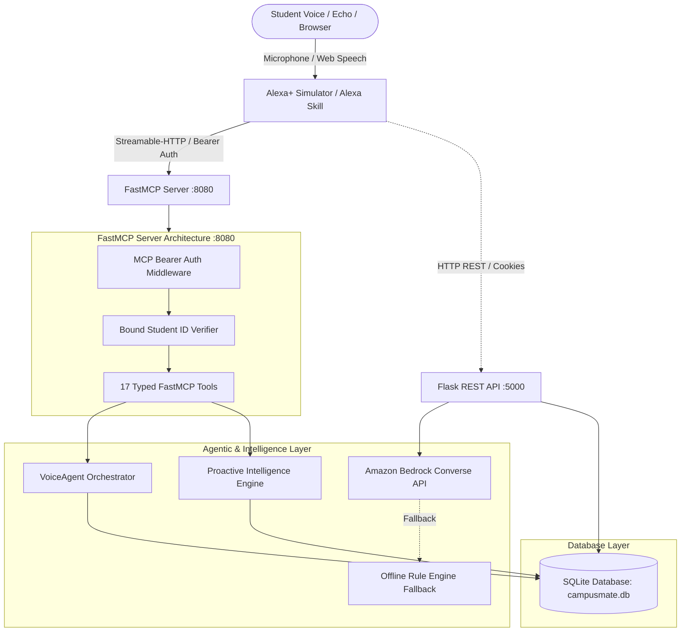
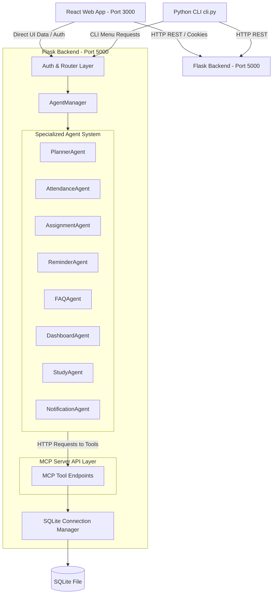

# CampusMate AI – Intelligent Student Concierge Agent (Alexa+ Track)

> **Built for the Amazon Developer Hackathon (Alexa+ Track)**  
> An autonomous, multimodal student concierge that bridges academic scheduling, attendance tracking, and study planning to the **Alexa+ Agent Framework** via a self-hosted **Model Context Protocol (MCP)** Streamable-HTTP server and optional **Amazon Bedrock** reasoning.

---

### 🌟 Hackathon Pitch & Overview
CampusMate AI eliminates student cognitive overload by orchestrating specialized multi-agent workflows through standard **Model Context Protocol (MCP)** tools. Whether speaking to an Echo device, interacting with the multimodal web simulator, or reviewing dashboards, students can issue natural multi-step commands like *"Alexa, plan my evening"* or *"Alexa, am I at risk of attendance cutoff?"*. The agent autonomously chains schedule inspection, assignment auditing, and dynamic study generation into concise, natural spoken responses.

- **Base Attribution:** Built on top of the open-source base repository [`TechEra007/Capstone-Campusmate-AI`](https://github.com/TechEra007/Capstone-Campusmate-AI), distributed under the **MIT License**.
- **Execution Model:** Works **100% offline by default** using local heuristic engines and rule-based planning (zero required API keys). Optionally connects to **Amazon Bedrock** (`Claude 3 Haiku` Converse API) for conversational reasoning and intent extraction.
- **Protocol Standards:** Runs a dual architecture featuring a classic Flask REST API server alongside a production-ready **FastMCP Streamable-HTTP Server** (spec compliant) protected by Bearer token authentication.
- **Full Audit Report:** See [`HACKATHON_REPORT.md`](HACKATHON_REPORT.md) for full benchmark validation logs.

---

### ⚡ Quick Start (5 Commands or Fewer)

```bash
# 1. Install dependencies
pip install -r requirements.txt

# 2. Run the full test suite (60 tests)
python -m unittest discover -s tests

# 3. Start the FastMCP Streamable-HTTP server (:8080)
python start_mcp.py

# 4. Start the Flask REST API & Backend (:5000)
python backend/app.py

# 5. Launch the Alexa+ Web Simulator (:3001)
python -m http.server 3001 --directory alexa-sim
```
*Visit `http://localhost:3001` in Chrome or Edge to interact via microphone or keyboard.*

---

### 📊 What Was Built During Hackathon vs. Original Base

| Component / Layer | Original Base Repo (`TechEra007`) | Built During Hackathon (Alexa+ Track) |
| :--- | :--- | :--- |
| **MCP Server** | REST API endpoints acting in MCP style | **Official FastMCP Python Server** on `streamable-http` with Bearer auth middleware, MCP handshake, and session IDs |
| **Voice Interface** | None (React web UI & CLI only) | **Alexa+ Web Simulator** (`alexa-sim/`) with glowing audio-reactive orb, Web Speech API STT/TTS, and live Tool Inspector |
| **Alexa Skill** | None | Complete **Alexa+ Agent Skill manifest & schema** (`alexa-skill/skill.json`) |
| **Multi-Step Orchestrator**| Manual navigation across tabs | **`VoiceAgent`** (`backend/agents/voice_agent.py`) chaining multi-step voice requests into single spoken answers |
| **Proactive Intelligence** | Basic manual threshold check | **`proactive_service.py`**: Attendance risk cutoff alerts (<75%), 48-hour deadline conflicts, exam overlaps, and weekly summaries |
| **LLM Reasoning** | Offline heuristics only | **Amazon Bedrock Converse API** (`Claude 3 Haiku`) integration with automatic fallback to offline demo engine |
| **Tools Count** | 8 basic endpoints | **17 Typed MCP Tools** + unified registry with strict JSON schemas and destructive confirmation tokens |
| **Test Coverage** | ~10 basic tests | **60 Automated Unit & Integration Tests** protecting baseline behavior and validating all MCP flows |

---

### 🛠️ Exposed MCP Tools (17 Tools)

1. `list_tasks`: Query assignments filtered by pending/completed.
2. `add_task`: Create tasks with validated dates and course associations.
3. `update_task`: Modify task properties with ambiguity resolution.
4. `complete_task`: Mark tasks finished by ID or title substring.
5. `delete_task`: Destructive deletion guarded by cryptographic confirmation tokens.
6. `add_exam`: Record upcoming exam dates and preparation notes.
7. `list_exams`: List scheduled midterms and finals.
8. `set_study_hours`: Configure available study windows per weekday.
9. `generate_study_plan`: Generate balanced calendar study slots.
10. `save_study_plan`: Commit study slots to the calendar.
11. `get_today_summary`: Consolidated daily agenda (classes + tasks + study blocks).
12. `get_attendance_summary`: Course attendance percentages with consecutive class cutoffs.
13. `search_faq`: Natural language search across campus regulations and policies.
14. `daily_briefing`: **(New)** Natural spoken morning summary combining timetable, attendance warnings, and urgent tasks.
15. `get_dashboard`: **(New)** Student standing, GPA, and upcoming workload metrics.
16. `get_timetable`: **(New)** Weekly course schedule with lecture rooms and timings.
17. `calculate_cgpa`: **(New)** Current CGPA and projected semester GPA calculations.

---

## 🏛️ System Architecture



---


## 🚀 Key Base Architecture Concepts

### 1. Multi-Agent System
CampusMate AI coordinates eight specialized agents using a mediator/orchestrator pattern managed by the `AgentManager`.
* **Agent Isolation:** Agents never communicate directly; all inquiries and responses flow through the `AgentManager`.
* **Data Boundary Constraints:** Agents are strictly forbidden from accessing the database directly. They query and modify database states only by invoking REST tool endpoints on the local service layer.
* **Specialized Agent Roles:**
  * **PlannerAgent:** Generates study schedule structures using subject credits, difficulties, and upcoming assignment deadlines.
  * **AttendanceAgent:** Computes attendance percentages and predicts consecutive classes needed or missable.
  * **AssignmentAgent:** Groups, prioritizes, and alerts students of overdue or urgent assignments.
  * **ReminderAgent:** Combines the active day's timetable classes, study plans, and deadline tasks.
  * **FAQAgent:** Queries local static files using keywords matching to resolve campus policy questions.
  * **DashboardAgent:** Formats aggregated metrics into visualization datasets for React charts.
  * **StudyAgent:** Recommends focus hours and Pomodoro techniques for rigorous or low-performing subjects.
  * **NotificationAgent:** Monitors thresholds and records database alert warnings for risk conditions.

### 2. Dual Service Architecture
The system provides dual access layers:
1. **Flask REST API Layer (:5000):** Provides REST endpoints for web dashboards, authentication, and chat sessions.
2. **FastMCP Server (:8080):** A dedicated Model Context Protocol server exposing standard tools over Streamable-HTTP for modern agentic clients.

### 3. Security Engineering
* **Session Management:** Built using `Flask-Login` with secure, HttpOnly session cookies.
* **Password Hashing:** Enabled using `Werkzeug` secure salting and hashing.
* **SQL Injection Prevention:** Implemented across all SQLite queries using parameterized parameters (`?`).
* **Cross-Site Scripting (XSS) Prevention:** Handled by escaping input parameters in middleware sanitizers.
* **Defensive Security Headers:** Attached on every response (`X-Content-Type-Options: nosniff`, `X-Frame-Options: DENY`, `Content-Security-Policy`).
* **Rate Limiting:** Managed in-memory using an IP-based sliding window decorator preventing endpoint spamming.
* **Role Based Authentication:** Restricts admin operations from student panels.

* **Cross-Site Scripting (XSS) Prevention:** Handled by escaping input parameters in middleware sanitizers.
* **Defensive Security Headers:** Attached on every response (`X-Content-Type-Options: nosniff`, `X-Frame-Options: DENY`, `Content-Security-Policy`).
* **Rate Limiting:** Managed in-memory using an IP-based sliding window decorator preventing endpoint spamming.
* **Role Based Authentication:** Restricts admin operations from student panels.

### 4. Interactive CLI & React Portal
* **CLI Client (`cli.py`):** An interactive terminal utility. Log in and print academic timetables, dashboards, study plans, or query FAQs directly using clean ASCII lists.
* **React Portal:** A modern Material-inspired dashboard styled with Tailwind CSS, supporting dark/light mode toggles, interactive progress rings, and real-time notification drops.

---

## 📊 System Architecture Diagram



---

## 📁 Folder Structure

```
CampusMateAI/
├── backend/
│   ├── app.py                  # Server entry point & configurations
│   ├── config.py               # Security and database environment configurations
│   ├── agents/                 # Heuristic and specialized agent source files
│   │   ├── base_agent.py       # Wrapper for MCP tools calls
│   │   ├── agent_manager.py    # Hub/Mediator coordinating sub-agents
│   │   ├── planner_agent.py
│   │   ├── attendance_agent.py
│   │   ├── ...
│   ├── auth/                   # Password verification and session loaders
│   ├── database/               # Schemas, seeding scripts, and SQLite files
│   │   ├── schema.sql
│   │   ├── seed.py
│   │   └── faq.json            # Static FAQ knowledge base
│   ├── middleware/             # Rate limiters, security headers, and logger configurations
│   └── routes/                 # Blueprints for auth, mcp tools, and agent endpoints
├── frontend/
│   ├── src/
│   │   ├── App.jsx             # Client-side router and layouts shell
│   │   ├── main.jsx            # React 18 rendering client
│   │   ├── index.css           # Tailwind layers and scrollbar designs
│   │   ├── components/         # Navbars, Sidebars, and ProgressRings
│   │   ├── context/            # Theme context and Session Auth context
│   │   ├── pages/              # Portal pages (Login, Dashboard, Planner, etc.)
│   │   └── services/           # Axios instance configuration
│   ├── Dockerfile
│   ├── tailwind.config.js
│   └── index.html
├── tests/                      # Suite tests (Auth, MCP tools, Agents, and APIs)
├── cli.py                      # Interactive console CLI client
├── docker-compose.yml          # Container configuration
├── requirements.txt            # Python dependencies
└── README.md                   # System documentation
```

---

## ⚙️ Local Deployment & Installation

### Option 1: Native Installation

#### 1. Setup Backend
1. Ensure Python 3.10+ is installed.
2. Navigate to the project root and install requirements:
   ```bash
   pip install -r requirements.txt
   ```
3. Run the Flask application:
   ```bash
   python backend/app.py
   ```
   *Note: This automatically initializes and seeds the SQLite database (`backend/database/campusmate.db`) with mock data on launch.*

#### 2. Run the Interactive CLI
1. Open a new terminal window at the project root.
2. Start the CLI client:
   ```bash
   python cli.py
   ```
3. Use credentials: `student` / `password123` to log in.

#### 3. Setup Frontend
1. Ensure Node.js v18+ is installed.
2. Navigate to the `frontend/` directory and install packages:
   ```bash
   cd frontend
   npm install
   ```
3. Start the Vite React development server:
   ```bash
   npm run dev
   ```
4. Access the web portal in your browser at: `http://localhost:3000`.

---

### Option 2: Docker Compose Deployment

1. Ensure Docker and Docker Compose are installed.
2. At the project root, build and run the services:
   ```bash
   docker-compose up --build
   ```
3. Access:
   * Frontend: `http://localhost:3000`
   * Backend API: `http://localhost:5000`

---

## 🧪 Running the Test Suite

We provide a comprehensive unittest suite containing 60 tests covering authentication, tenant isolation, tool schema validation, confirmation tokens, Amazon Bedrock Converse integration, multi-turn chat history, planner boundaries, FastMCP tools, and VoiceAgent orchestration. Run it using:
```bash
python -m unittest discover -s tests
```
*Expected: 60 tests passing (`OK`).*


---

## 🎓 Antigravity Demo Steps (End-to-End Workflow)

Follow this sequence to inspect the entire ecosystem:

1. **Start the Backend:** Start `python backend/app.py`. Check logs to verify SQLite file initialization.
2. **Access Web Login:** Open `http://localhost:3000/login`. Log in with username `student` and password `password123`.
3. **Inspect the Dashboard:** Observe live counts and visual charts. The bar chart displays attendance by course.
4. **Trigger the Study Planner:** Navigate to "Study Planner" on the Sidebar. Click **Generate Study Plan**. The `PlannerAgent` will calculate study slots. Review the slots and click **Save to Calendar** to commit the slots to the database.
5. **Simulate Attendance Metrics:** Navigate to "Attendance". Review warning advice tags (e.g. CS105 has low attendance). Try the **Skip Calculator** on the right side: select CS102, adjust skipped classes count, and observe how the rule engine recalculates projected attendance and details consecutive class recoveries needed if it drops below 75%.
6. **Browse FAQ Directory:** Go to "Campus FAQ". Type `"where is library?"` and press search. Observe how `FAQAgent` fuzzy-matches and displays answers. Select accordions to expand predefined FAQs.
7. **Toggle Dark Mode:** Click the Sun/Moon icon on the Navbar. Verify all charts and UI components render with the dark color palette.
8. **Test the CLI:** Run `python cli.py` in your terminal. Log in with `student` / `password123`. Choose Option `5` (Reminders) to view consolidated daily reminders, or Option `8` to run CGPA projections directly in the console.

---

## 📝 License
Distributed under the MIT License. See [LICENSE](LICENSE) for more information.

